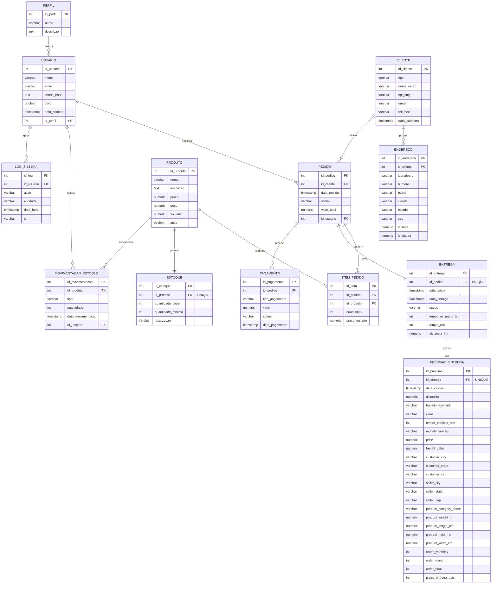

### 🏢 AGERP - Enterprise Resource Planning


**AGERP** é um sistema ERP completo desenvolvido como Trabalho de Conclusão de Curso (TCC). Combina um backend robusto em **Java + Spring Boot** com um frontend moderno em **React + Vite**, utilizando autenticação via **JWT** com **HttpOnly Cookie**.

## 🏗️ Tecnologias Utilizadas

### Backend

```
- Java 21/25 + Spring Boot 3
- Spring Security + JWT
- Spring Data JPA + Hibernate
- PostgreSQL
- Maven
- Docker & Docker Compose
```

### Frontend

```
- React 18 + TypeScript
- Vite (build tool)
- Tailwind CSS
- React Router DOM
- Axios
```

### Infraestrutura

```
- Docker
- Docker Compose
```

## 📁 Estrutura Completa do Projeto

```
AGERP/
├── backend/                          # API Spring Boot
│   ├── src/main/java/com/agerp/agerp/
│   │   ├── config/
│   │   ├── controller/
│   │   ├── dto/
│   │   ├── entity/
│   │   ├── repository/
│   │   ├── security/
│   │   │   └── jwt/
│   │   ├── service/
│   │   └── AgerpApplication.java
│   ├── src/main/resources/
│   ├── pom.xml
│   └── application.properties
│
├── frontend/                         # React + Vite
│   ├── public/
│   ├── src/
│   │   ├── api/
│   │   ├── assets/
│   │   ├── components/
│   │   ├── contexts/
│   │   ├── hooks/
│   │   ├── pages/
│   │   ├── routes/
│   │   ├── services/
│   │   ├── utils/
│   │   ├── App.tsx
│   │   └── main.tsx
│   ├── package.json
│   ├── vite.config.ts
│   └── tailwind.config.js
│
├── docker-compose.yml
├── README.md
└── .env.example
```

## 🗄️ Diagrama de Entidade-Relacionamento (DER)



## 🚀 Como Rodar o Projeto

### Backend

```
cd backend
mvn clean install
mvn spring-boot:run
```

A API Java estará disponível em: `http://localhost:8080`

### Frontend

```
cd frontend
npm install
npm run dev
```

O frontend estará disponível em: `http://localhost:5173`

---

## Funcionalidades Implementadas

- Autenticação com JWT + HttpOnly Cookie
- Gestão de Usuários e Perfis (ADMIN, GERENTE, OPERADOR, FINANCEIRO)
- Dashboard dinâmico
- CRUD de Clientes (em desenvolvimento no React)
- Estrutura completa preparada para expansão

---

**Próximos Passos:**

- Finalizar CRUD de Clientes no React
- Implementar gráficos no Dashboard
- Criar microsserviço de IA para previsão de entregas
- Preparar ambiente de produção com Docker Compose

---

Feito por Gabriel Filipi Pontes

Última atualização: Abril 2026
